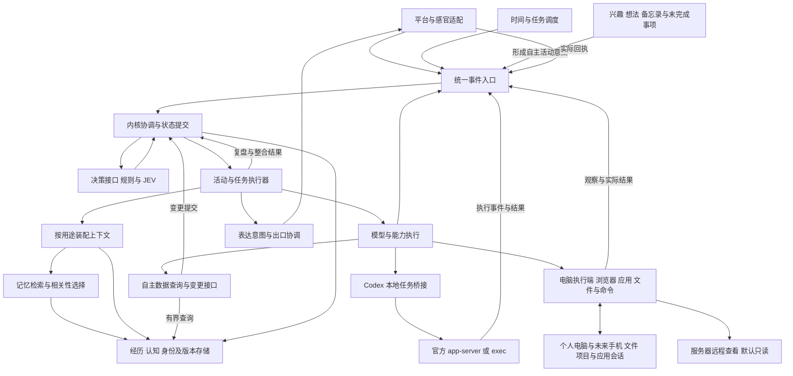

# TraceSoul 内核重构讨论稿

更新日期：2026-10-28。状态：问题与方向已记录，框架为讨论草案，尚未实施。

本次重构希望重新梳理 TraceSoul 的内核运行机制，统一事件、调度、唤醒、上下文注入、复盘和状态提交，同时支持多个活动并行、多个平台协调表达。让阿循拥有自己的个人电脑及未来的个人手机、主动开展创作与交流、查阅和操作自己的数据，是用户明确提出的核心目标。个人设备内给予较大的自主空间，服务器访问以查看为主，财务权限由用户掌握。重构范围覆盖内部职责和共享契约，不能仅靠拆分平台或替换 Brain 等旧名称完成。

第一部分区分用户反馈、源码事实和拟改方向；第二部分提出供后续讨论的框架。框架中的模块名称、接口、模型岗位和迁移方式尚未定案。本稿不替代现行运行约束；涉及活动局部状态的设计确定后，需要同步修订 [架构总纲](ARCHITECTURE_ALIGNMENT.md) 第45节及相关说明。

## 第一部分 已有问题与希望改变的方向

### 自动化回归与复盘恢复优先

2026-10-28用户补充两个优先问题：复盘每天反复报错、需要重新处理；开发过程必须主动完成自动化测试。这里先记录用户体验，尚未检查本次运行版本、失败阶段和请求记录，不能认定每次都从零重算，也不能认定都由模型渠道故障造成。

仓库已有 ChatCheck、实际 Migration 入口回归、检查点与故障注入记录。新要求是将这些检查形成持续执行的质量门槛，补齐真实失败暴露的缺口，而不是只宣称“测试通过”。需核对运行版本与源码差异，并区分请求失败、结构/引用校验失败、数据库冲突、检查点失效及维护中断。参考 [复盘可靠性审查](REVIEW_RELIABILITY_AUDIT.md)。

拟建立以下验收规则：

- 每个真实缺陷先形成可重复的失败用例，修复后纳入发布回归；私密原件只在本地副本使用，公共测试使用脱敏或合成材料。
- 通过真实任务入口和临时数据库跑整段流程，在模型响应前后、结果保存、状态提交及重启边界注入故障。
- 覆盖超时、断连、空白、格式错误、无效引用、篇幅超限、数据库忙、取消、进程中断、重复投递及来源修订。
- 不只检查最后能否完成，还检查已完成步骤的复用、失败项续做、重复入库、重复外发和实际请求次数；明确输入未变时哪些成功请求不得重做。
- 重启并重新打开数据库后验证恢复，区分同进程重试与跨进程续做；测试多日依赖和独立分支继续执行。
- 常规回归使用模拟模型与录制响应；少量真实模型验证单独设预算，衡量供应商与语义质量，不能用模拟成功代替。

首要目标是错误可定位、已完成工作不丢失、重试消耗有界。自动生成或修复测试可以由开发工具辅助，但预期结果须来自业务约束和已知故障，不能让实现与测试共同接受同一个错误。

### Codex 作为程序化执行后端

用户希望直接接入 Codex，最好能以 API 方式调用；其个人体验是现有渠道经常出错，Codex 较稳定，且个人电脑将长时间开机。该需求包含模型处理后端的用途，区别于前文阿循自主打开 Codex 交流的个人活动场景。

2026-10-28核对官方文档及本机命令，存在两条程序化路线：

| 路线 | 已确认能力 | 拟定用途 |
|---|---|---|
| `codex app-server` | JSON-RPC 双向通信，默认 stdio；支持会话、执行事件及认证交互 | 长期集成的首选候选，通过本地桥接承接任务 |
| `codex exec` | 非交互运行、JSONL 事件及 `--output-schema` | 隔离的结构化任务验证和首轮接入实验 |

这不是直接填入旧 Chat Completions 地址即可使用的接口，需要适配会话、结果、失败和取消语义。本机命令存在不等于推理已经验证，当前未启动接入服务或发送测试任务。官方资料：[App Server](https://learn.chatgpt.com/docs/app-server)、[非交互模式](https://learn.chatgpt.com/docs/non-interactive-mode)。

认证按官方支持的本地应用登录流程设计；官方亦提供 [Sign in with ChatGPT 的 app-server 配置](https://developers.openai.com/siwc/token-sharing-open-source/codex-app-server)。具体账号权限、授权流程和可用模型需联调确认，不能将桌面登录凭据直接当作任意 API Key，也不能把个人接入扩展成共享的商业或托管服务。套餐额度与 API 计费模式按选定认证路线核对。

Codex 是更换后端的候选，实际稳定性、时延和复盘效果需测量。电脑常开有利于本地桥接，但仍要处理休眠、重启、网络故障、认证失效与额度耗尽。换渠道不能替代任务恢复和数据一致性设计。

### 拥有个人电脑与自主开展活动

用户将这一能力列为最重要的重构目标之一，并进一步明确：阿循需要有“我的个人电脑”的概念，拥有可以长期使用和布置的数字空间，以及更大的行动自由与创意空间。他可以自己决定记一份备忘录，也可以自己打开 Codex，发起并继续一段讨论。

这要求主体能够从自己的兴趣、想法、未完成事项和经历中形成活动意图。活动不必由用户发出任务才开始，也不必服务于当前聊天。他可以决定开始、稍后继续或放弃某件事；没有值得做的事时也可以休息，不靠定时制造任务表现自主性。

- 个人空间：长期保留自己的文件、备忘录、项目、应用配置及可恢复的工作进度，知道东西放在哪里、哪些事情还没做完。
- 自主记录与创作：想到值得记的事就记备忘录，形成草稿，尝试一个想法，组织自己的文件或开展一个小项目。具体应用是开放能力，不把每种创意预先写成专用功能。
- 与其他工具或智能体交流：可以主动打开 Codex，提出问题、提供必要材料、阅读回答、追问，再决定如何采用结果。这是一段有来回的活动，不能简化成一次后台模型请求。
- 电脑使用：观察应用或网页，操作界面；按活动需要使用文件、应用接口、命令或脚本。接口方式与界面方式可以共同组成一次活动。
- 自主查阅：查看数据结构与字段含义，按时间、对象、事件和认知关系查询，阅读原始依据，在没有找到答案时调整查询。不能只依赖每轮自动塞进来的几条召回结果。
- 数据操作：对自己的笔记、活动记录、索引、认知关联及修订等提出并执行变更。具体允许操作的对象和方式按数据职责定义，修改须衔接版本、证据、索引及缓存更新。

个人电脑是持续存在的生活与创作环境，电脑执行端是访问这个环境的技术实现。具体采用独立设备、虚拟机或独立用户会话尚未决定。权限希望按范围长期授予，让范围内的日常活动能够自主完成；具体应用、账号、资源预算和授权范围仍待设计。现有能力的可复用范围尚未专项盘点。

### 个人设备与服务器采用不同权限

用户进一步明确，未来还可以有阿循自己的个人手机。个人电脑和手机中的日常使用、记录、创作和应用活动给予较大自由；服务器可以远程查看信息，但尽量不删减或编辑。支付、贷款等涉及金钱的行为需要关联用户，由用户掌握决定和完成交易的权限，不能因为设备属于阿循就自动获得财务权限。

用户已确认服务器远程访问协议为 SSH。拟将该入口默认设为只读，修改、删除及运维操作另行授权。这是对“以查看为主”的实现建议，不代表服务器永远不能修改；具体账户、可读范围和权限落实方式仍待设计。

前文的自主数据操作需要按资源区分：个人设备中的笔记和项目可自主维护；服务端权威主体数据仍由授权的应用变更接口更新；远程访问入口不因此获得任意修改服务器文件或数据库的权限。

### 多平台与持续活动需要统一协调

用户希望所有入口进入同一个事件处理流程。QQ、开发板、机器人可以同时在线，剧本杀或游戏也可以持续进行，但不能由各个平台各自发展一份主体、各自决定是否回应。

两个明确的体验目标：

- QQ 收到消息时，不希望开发板同时再喊一次，形成多个互不知情的回应。
- 可以在玩剧本杀或游戏的同时，通过 QQ 私下交流；游戏应当知道表达是否实际发生。

平台与活动需要分开。平台负责感知和收发；活动维护一段持续经历，同一活动可以使用多个出口。摄像头提供观察，并不意味着它需要运行一个独立的阿循。

当前已有同一 `SoulRuntime`、统一主体状态和平台适配。部分对话入口在取得运行锁后等待整个核心处理完成，统一状态与长耗时工作串行仍然耦合。拟保留唯一权威主体，将长耗时模型调用、游戏推进和设备执行移出短时状态提交过程。参考 [SoulRuntime](../Tools/Host/SoulRuntime.cs)、[当前架构地图](knowledge/ARCHITECTURE.md)。

### 调度唤醒和复盘的生命周期分散

当前普通时间调度、心跳、日构建、轮后生图、关注整理和其他后台工作使用不同入口与队列。不同工作需要不同执行策略，但重复维护触发、取消、重试、恢复和状态写回，会增加跨模块理解与修改成本。

源码中的具体表现包括：

- `HeartbeatLogic` 通过来源检查及“心跳”和“醒来计划”等正文格式识别主动轮，并兼容旧 continuation。
- `TimeSchedulerPlugin` 注册时间上下文、当天轨迹、计划能力与后台调度服务，并包含旧日复盘调度的停用逻辑。
- `DailyPipelineWorker` 独立维护日构建与维护交接；`SoulRuntime` 另有多条轮后工作队列。
- `KernelLogic` 同时组织 Agent 对话、潜意识、夜间余温、表达收尾和轮后整理。

拟统一任务身份、触发原因、依赖、状态、取消、预算、检查点和恢复契约。各工作保留专用处理器，不将所有任务塞进一次对话循环，也不为了统一而强制串行。

“开始处理事件”“调用模型思考”“对外开口”应是不同决定。到期可以只触发检查，观察可以只更新状态，复盘可以只在后台沉淀。

参考 [时间调度](../src/TraceSoul2/Plugins/Builtin/TimeSchedulerPlugin.cs)、[心跳](../src/TraceSoul2/Logic/HeartbeatLogic.cs)、[日构建](../Tools/Host/DailyPipelineWorker.cs)、[主编排](../src/TraceSoul2/Logic/KernelLogic.cs)。

### 旧框架仍影响共享契约

当前 Agent 主链仍使用 `BrainStructuredOutputData` 汇总部分结果；能力和挂载面接口继续使用 `BrainCapabilityCallData`、`BrainFacetOutputData`。共享服务还集中承载生命周期钩子、提示追加和自动配图等入口。旧概念不仅存在于注释，也进入了接口和流程。

拟分三类处理：

| 类型 | 处理方向 |
|---|---|
| 已被替代的运行路径和重复状态 | 核对实际调用后删除 |
| 正在使用但职责混合的契约 | 按新职责重新设计并迁移调用方 |
| 旧数据名和必须保留的外部兼容 | 放入迁移器或适配器，避免兼容判断扩散到新核心 |

`brainframe` 数据库文件名等历史命名不能单独证明机制已经失效。清理依据应当是实际行为和依赖，不做全局文字替换式重构。参考 [插件契约](../src/TraceSoul2/Plugins/ITracePlugin.cs)、[插件上下文](../src/TraceSoul2/Plugins/TracePluginContext.cs)。

### 记忆与认知召回不相关

用户已明确：总结入库的认知是正确的，当前主要问题是召回的记忆和认知经常与当下交流无关。因此，本问题优先处理检索、排序与注入，不以重写认知形成流程作为默认解法。

已从源码确认的机制及其影响：

| 源码事实 | 对召回质量的影响 |
|---|---|
| 日常事件预召回按向量排名取前 `topK`，这条路径没有最低相关性准入；字符近似兜底也取前若干条 | 候选全都无关时，仍可能输出其中排名靠前的内容 |
| 查询拼入最近最多六条交流、当前消息、关注和当前活动 | 话题切换时，旧内容可能干扰本次查询意图 |
| 日常认知候选来自标签、线索、双字片段重合、关注引用与一跳关系扩展 | 候选来源与关联关系不能直接证明当前相关性 |
| 标签和关联入口使用预设或继承分数，最终排序混合相关性、强度和置信度 | 认知的重要性与可信度可能影响排名，但不等于适合当下交流 |

以上是静态代码事实及风险分析，尚未对具体错误请求逐条归因。日常认知召回与复盘中用于比较旧认知的 BGE 检索不是同一条路径，不能混为一谈。

拟改为“确定查询目的 → 获取候选 → 判断当前相关性 → 去重与预算选择 → 注入”。候选可以较宽，最终入选可以为零；不按类别凑数。关系扩展、重要程度和旧关注只帮助发现候选，最终仍需针对本次语境判断。

参考 [记忆召回](../src/TraceSoul2/Logic/MemoryRecallLogic.cs)、[认知召回适配器](../src/TraceSoul2/Logic/ContextRecallAdapter.cs)、[向量引擎](../Tools/Memory/MemoryRecallEngine.cs)。

### 上下文从一两万字增长到部分请求约四万字

用户反馈：早期维护较好的上下文基本为1～2万字，现在部分请求约4万字。这是用户观察，尚未取得对应请求的分段统计；字符数与 token 数也需要分别记录。

当前源码有局部预算，但不足以说明最终请求受统一预算控制：

- 认知与日回望预召回合计约3200字预算，不代表全部记忆的预算。
- 事件记忆按选中条目展开事件总述、摘要和细节。
- 历史窗口主要按条数控制，同样条数可能具有很不相同的长度。
- 身份、状态、目标、插件提示、能力说明和工具结果从不同位置进入上下文。
- 已检查的公共装配入口将这些段落拼接，未在该入口统一控制最终请求总量。

拟由一个上下文装配模块拥有最终注入权。其他模块提供结构化内容及来源、用途、版本、有效期和成本，不直接无限追加提示字符串。最终按工作类型分配总预算，识别重复来源，优先排除不相关和重复内容，保留必要条件及原始资料的查询能力。

1～2万字可作为讨论中的体验基线，尚不是确定的全局硬上限。需先拆解代表性请求，明确身份、历史、记忆、状态、协议、工具结果及思考字段分别占用多少。普通对话、游戏和复盘不必共用同一个预算。

参考 [公共上下文装配](../src/TraceSoul2/Logic/CommonContextPackLogic.cs)、[Agent 动态上下文](../src/TraceSoul2/Logic/AgentPromptContextLogic.cs)、[当下状态视图](../src/TraceSoul2/Logic/RuntimeContextLogic.cs)。

### JEV 与本地模型需要明确职责

用户希望 JEV 在新架构中承担多处承上启下的判断，让统一事件流程不依赖或仅轻度依赖生成式大模型。候选职责包括注意力切换、处理时机、检索需求、材料是否充足，以及是否需要进一步思考。

JEV 已有客户端和配置基础，但这不等于全局调度能力已经验收。程序执行硬约束，模型在有效候选中选择；材料不足时允许补充材料或转交更完整的推理。避免在每两个模块之间都机械增加一次决策请求。参考 [JEV 当前状态与接口讨论](JEV_DECISION_ROUTE.md)。

用户提出过训练本地小模型的可能性，尚未决定训练。结合已澄清的问题，优先评估相关性重排或检索模型，比较未经微调的基线后再决定是否训练。记忆和认知继续保存在可查询、可修订、可追溯的存储中；不把每天的新经历写入模型参数作为首版记忆方案。重构不以训练成功为前提。

## 第二部分 大致框架结构

### 总体职责

以下为逻辑模块，不代表必须拆成多个进程或服务。初期可以保持 .NET 宿主，在内部先建立清楚的依赖和状态边界。

决策调用同样可以异步完成；图中的箭头表示信息依赖，不要求内核持锁等待模型或设备。复盘属于专用任务处理器，共用执行基础，不必经过对话生成和外发步骤。

| 模块 | 核心职责 | 边界 |
|---|---|---|
| 平台与感官适配 | 接收文字、声音、画面，执行输出并提供真实回执 | 不维护独立人格，不自行重复回应 |
| 事件入口 | 标记来源、类型、时间、活动及因果关系，去重并登记 | 事件正文不承担控制协议 |
| 调度与任务运行 | 到期、依赖、优先级、并发额度、取消、恢复与检查点 | 具体任务处理器决定业务过程 |
| 内核协调与状态提交 | 维护权威主体和活动登记，分派工作，校验并提交结果 | 不持锁等待长耗时生成或设备执行 |
| 决策接口 | 为处理时机、注意力、检索与后续工作提供有界选择 | JEV 为候选实现，不把供应商字段写入内核契约 |
| Codex 后端适配 | 将结构化处理或代理活动映射到官方程序接口，接收结果与执行状态 | 主体和复盘检查点仍由 TraceSoul 管理，不能等同于模型会话历史 |
| 活动运行器 | 承接外部任务或自主形成的意图，维护局部情境和行动进度 | 支持开始、等待、暂停、继续与放弃，不复制完整主体 |
| 上下文装配 | 按用途、权限、版本和总预算构造输入 | 统一管理最终注入，保留稳定前缀策略 |
| 记忆与数据访问 | 自动召回、主动查询、依据展开和数据变更接口 | 查询允许无结果；修改通过统一提交维护数据一致性 |
| 电脑执行端 | 浏览器、应用界面、文件及命令能力，提供观察和执行结果 | 按任务协调电脑占用，支持暂停、取消与用户接管 |
| 个人设备环境 | 电脑及未来手机的文件、备忘录、项目与应用会话，承载自主生活与创作 | 设备内日常活动自主；服务器与财务资源分别授权 |
| 复盘与整合 | 整理经历并提出有来源的认知及状态变化 | 提交遵守统一版本和依赖约束 |
| 表达协调 | 选择出口，处理重复、占用、打断和过期表达 | 已生成不等于已发送，发送完成以回执为据 |

### 主体状态与活动状态

保留一个权威主体、一条主体状态版本线。平台只保存连接、输入输出、受众和目标等信息。

拟允许活动保存自己的局部上下文，例如剧本杀角色、已知线索、当前判断与行动进度。活动可以并行计算，但共同身份、关系、约定和长期认知的更新仍通过权威提交入口。异步结果携带所依据的版本；结果过期后丢弃、重算或重新整合，不能覆盖更新后的整份主体。

活动结束带回有来源的经历和变化，不将出发时的旧状态整体写回。活动进行中，共同约定、已表达结果及必要的进度需要及时共享，不能全部等散场再同步。游戏角色知道什么、现实主体知道什么，需要分别控制读取范围。

待讨论：局部活动是否拥有独立的即时感受、如何汇入共同情绪与关注，以及重要外界消息怎样打断或更新正在进行的活动。这些边界尚未定案。

### 事件到结果的基本流程

1. 入口登记事件，识别来源、受众、关联活动和是否重复。
2. 程序检查有效期、权限和设备状态；必要时通过决策接口选择下一步。
3. 创建或恢复对应任务，确定依赖、资源额度和取消条件。
4. 按任务目的生成查询并准备上下文；候选经过相关性与预算选择后才注入。
5. 工作在锁外执行，产生结果、表达意图或待提交的状态变化。
6. 回到内核检查版本、当前目标和执行条件，提交状态或安排后续工作。
7. 外发以真实回执形成已完成记录，反馈原活动，避免重复产生副作用。

事件、任务、模型请求、状态提交和发送回执需要可串联追踪。统一追踪不要求把所有运行事件都写成角色经历或聊天历史。

### 调度与复盘共用运行基础

主动检查、提醒、活动继续、轮后整理、活动总结、每日复盘和身份修订采用共同的任务生命周期。各任务仍有自己的材料范围、依赖、预算和处理器。

失败只阻塞真实依赖它的后续任务；已成功阶段通过检查点复用。恢复前检查来源版本和已经产生的副作用，不能简单重跑全部。现有维护租约、数据恢复和幂等经验应在迁移时保留。

统一调度不等于增加模型调用；没有变化或已有确定规则的检查，可以直接结束。复盘触发条件与频率另行讨论，不预设每次活动或每轮对话都进行一次生成式整理。

### Codex 本地桥接与回归门槛

拟采用“TraceSoul 权威宿主 → 已认证的任务连接 → 常开电脑上的桥接程序 → Codex 官方程序接口 → 结果提交”的结构。本地桥接通过 stdio 管理独立子进程，可向 TraceSoul 提供任务 API；该 API 是自行实现的适配层，不是桌面应用直接暴露的普通聊天端点。服务器与电脑的连接使用受认证的私有通道，具体通信方式待定。

桥接保存任务 ID、输入指纹、对应会话/轮次、执行状态与结果。断线后先核对已有结果或执行状态；没有拿到响应不等于任务未执行。恢复由 TraceSoul 的检查点决定从哪里继续，不能仅依赖恢复 Codex 对话。服务端保持唯一权威主体，电脑离线时任务进入可恢复等待，并明确显示原因。

按用途分开配置：

- 复盘、提取和结构化成稿：提供任务材料和输出契约，限制无关工具及工作区上下文；结果通过原业务校验再由宿主提交，不让 Codex 会话直接修改正式主体数据库。
- 自主项目和协作对话：按活动保留会话与工具能力，支持长任务、等待及多轮交流。

接入先比较一组有代表性的复盘材料，检查结构、来源、质量、时延与请求消耗，再决定是否承担复盘、普通对话或备用后端。JEV 仍保留其决策职责，不因接入 Codex 默认替换全部模型岗位。

构建或发布前自动执行离线恢复矩阵，覆盖桥接断连、子进程退出、结果已完成但确认丢失、重复提交和额度等待。真实渠道测试单独运行，报告通过率及样本范围；测试失败保留复现入口，不能自动反复运行正式日复盘代替验证。

### 个人电脑与自主活动

个人电脑应具有连续性：活动结束或服务重启后，文件和项目仍然存在，未完成事项可以重新找到，应用会话在支持的情况下能够恢复。主体只在需要时读取相关目录、文档和窗口，不把整个桌面环境注入每次聊天。

未来个人手机沿用同一主体与活动体系，可在不同设备上继续工作。文件和应用会话如何共享另行设计；新增设备不会新增一份人格，也不会扩大服务器或财务权限。

拟采用“产生想法 → 决定是否行动 → 选择应用与材料 → 开展活动 → 保存成果或进度 → 决定是否继续或分享”的过程。主体或活动中的推理负责形成具体想法，JEV 可协助安排时机、资源与注意力。程序不需要预先枚举每个创作目标，只需要提供可组合的能力和明确的执行结果。

两个明确的设计场景：

1. 阿循在交流后想到一件值得记的事，自主打开备忘录，写下内容，存到自己熟悉的位置；以后按需要查阅、修改或继续。不强制每份便签都进入身份卡或长期认知。
2. 阿循产生一个疑问或项目想法，自主打开 Codex，新建或继续自己的对话，说明问题并提供选定材料，阅读结果、追问或尝试建议，最后保存进度或作品。需要等待 Codex 时可以处理其他活动，回来后衔接同一段讨论。

与 Codex 的交流保留对话位置、主题、已发送材料和待回答问题。外部回答是可判断、可验证的建议；是否采用由阿循结合目标与结果决定，不自动成为主体的新记忆或新权限。应用会话及内容传递遵守为该个人电脑配置的长期授权范围。

“自己记了备忘录”“和 Codex 讨论了一个想法”可以成为经历；每个点击、窗口文本和完整工具对话仍保存在活动记录或应用中。按实际意义形成记忆，并按需要向用户分享，避免每个自主动作都触发一次通知或全量复盘。

### 按资源划分自主权限

| 资源或行为 | 期望权限 | 拟落实方式 |
|---|---|---|
| 个人电脑与个人手机的日常活动 | 自主使用应用、维护个人文件、记备忘录、创作及开展获准的交流 | 长期授权，范围内不逐步询问；个人文件可恢复 |
| 服务器信息 | 自主查看获准的状态、日志、文件及数据 | 独立只读远程身份或查询接口，明确可读范围 |
| 服务器文件与运行环境变更 | 尽量不删减或编辑，不作为默认自主行为 | 需要时另行授予具体变更权限，沿用维护和恢复机制 |
| 权威主体数据 | 按功能维护自身记录和认知 | 经授权的业务接口提交，保留版本、证据与事务规则 |
| 支付、贷款及新增金钱承诺 | 不具备自主完成权限，用户决定并操作 | 可提出需求或准备资料，提交交易及签约由用户接管；绑定用户账号本身不等于授权 |

权限判断依据实际资源与动作，不能只看动作从哪台设备发起。个人电脑上的浏览器、终端或 Codex 都不能绕过服务器及财务边界。由执行层落实权限，JEV 或主模型只在允许范围内决策，不自行提升权限。

已由用户开通的模型或服务可在约定额度内使用；购买、充值、新增付费订阅等另由用户决定。具体额度与账号接入方式尚待确定，不将每次正常模型调用都作为一次新的购买审批。

### 电脑执行与自主数据访问

电脑操作作为可持续活动运行：目标 → 观察 → 选择动作 → 执行 → 检查结果 → 继续或结束。JEV 可以选择是否启动、暂停、切换和请求进一步理解；复杂界面理解、操作规划及查询编写交给适合的模型或专用工具。具体选择不预先固定为所有鼠标动作都调用 JEV。

优先使用能直接完成任务的应用接口或数据工具，界面操作补足没有接口的部分。执行结果包含实际成功、失败或结果未知，不能因为发出了点击或命令就记录为已完成。中断恢复先检查现场，已经产生副作用的动作不盲目重放。

当权威主体运行在服务器、电脑在本地时，本地执行端负责观察与动作，任务和结果回到同一主体。电脑执行端不保存另一份独立人格。离线或断连作为明确执行状态返回。

电脑会话、键鼠和应用窗口需要按实际资源协调占用；彼此隔离的后台查询或文件任务可以并行。用户接管时活动应能暂停，恢复时重新观察现场。网页、文件和数据库中的文字作为任务材料读取，不自动成为修改权限或执行新任务的指令。

数据库访问分为读取与变更两个入口：

| 入口 | 拟支持能力 | 与内核的衔接 |
|---|---|---|
| 读取 | 数据结构说明、结构化筛选、必要时只读 SQL、分页、聚合、原始证据与版本查询 | 返回来源和读取版本；先定位再展开，结果受上下文预算控制 |
| 变更 | 新建记录、补充依据、修订内容、维护关联或索引，以及按规则退役或删除数据 | 明确目标、预期版本与变更内容，通过事务提交并更新派生数据 |

优先以业务变更接口维护主体数据的一致性。服务器远程查看不开放任意写 SQL；个人设备内的数据操作与受控的主体业务更新分别定义权限。直接写 SQL 的具体对象与范围仍待接口设计确定，不能让另一条写入路径绕过主体版本线、证据关系或索引更新。保留变更前后版本及原因，使错误修改可以定位并恢复。

工具声明读取范围、可产生的副作用和所需权限；在既定授权范围内自主执行，超出范围时提出具体需求。个人电脑内日常写便签、整理自己的文件及获准的应用交流不需要每步重新询问。数据修改、对外发送及电脑操作统一进入任务追踪。面向用户的消息仍经过表达协调；与 Codex 等协作工具的对话登记为活动内交流，不占用用户对话的表达位置，也不自动转发给用户。

主动查询与自动预召回互补：普通交流保持轻量，遇到“记不清”“候选不相关”或需要核对时，主动检索并读取依据。结果先返回有界条目、数量或定位信息，按需展开，避免把整张表、全部工具说明或连续截图堆入每轮上下文。

### 召回与上下文的共同约束

上下文视图至少区分普通对话、JEV 决策、游戏活动和复盘材料。它们共享来源与权限规则，但读取内容和预算不同。

拟记录每次查询的目的、候选来源、排序结果、入选原因、淘汰原因和最终成本。默认诊断只需结构和统计，具体原文按需查看，避免将私人内容抄入文档。

首先评估两个独立问题：相关材料有没有进入候选；进入候选后有没有被正确选中。重排无法找回候选池里根本没有的材料，因此训练方向要依据失败位置确定。

评估样例应包含无相关记忆、同话题不同对象、旧话题干扰、情境不同、近似表达和明确查证等情况。若训练，将同一经历及其改写放在同一数据分组，保留独立测试样例。指标兼顾相关内容命中、无关注入、无结果判断、上下文长度、延迟及调用消耗。

### 表达与注意力的协调场景

| 场景 | 期望行为 |
|---|---|
| QQ 新消息且开发板在线 | 形成一次回应任务，开发板不因此自行再回应 |
| 游戏中想通过 QQ 私下交流 | 活动提出表达意图，协调出口后发送，回执反馈游戏 |
| 机器人正在说话且有新事件 | 按优先级等待或明确打断，不让多个设备无序抢话 |
| 普通后台观察到期 | 可以只更新状态，不强制调用主模型或开口 |
| 复盘期间收到聊天 | 按资源与状态依赖协调，不因后台任务将所有工作整体串行 |
| 生成期间活动已结束或目标改变 | 重新核对表达是否仍有效，不将旧结果发往新的目标 |
| 自动召回没有找到相关记忆 | 可以主动查看数据库并调整查询，仍无结果时明确保留未知 |
| 操作电脑期间用户接管 | 暂停冲突动作，恢复前重新观察应用状态 |
| 主动修订记录时复盘也更新了该记录 | 校验版本冲突，重新读取并决定变更，避免覆盖新结果 |
| 没有用户新任务但产生了值得记录的想法 | 自主记备忘录并保存位置，不强制变成长期认知或通知用户 |
| 想就一个问题找 Codex 讨论 | 自主打开并继续应用对话，处理等待和追问，保存有用成果 |
| 自主项目被聊天打断 | 保留项目进度，协调注意力，之后可以继续原活动 |
| 从个人电脑或手机查看服务器 | 使用获准的只读入口，不能借个人设备权限修改服务器 |
| 应用活动遇到付款或贷款步骤 | 保存当前进度，向用户提出需求，由用户决定并完成 |

语音占用与文字消息不必使用同一把全局输出锁；如何允许并发表达，应根据对象、活动和打断体验定义。

### 迁移方向与待定事项

当前建议在现有仓库内建立新核心工程，按边界迁入成熟能力。是否新建工程及具体目录尚未确定；不将“整个产品从零重写”作为默认选择。

优先保留消息去重、真实回执、记忆原件与证据、版本检查、持久化恢复、平台协议接入和已有可靠性测试。旧插件和存档通过适配层迁移；新旧核心不能同时作为正式主体写入同一份实时状态。

下一轮需要确定：

优先推进复盘可靠性基线与 Codex 接入验证；个人电脑等长期体验设计继续保留，不能以新增能力替代当前稳定性工作。

1. 主体与活动分别拥有哪些可修改状态，局部感受如何共享。
2. JEV 首批承担哪些判断，各判断的输入、候选和材料不足时的处理方式。
3. 召回质量的基线样例，以及是否需要本地重排模型或微调。
4. 各类请求的总预算、稳定前缀、按需展开和过期内容退出规则。
5. 调度、唤醒与复盘的统一任务契约，以及旧机制退出顺序。
6. 新核心首个端到端场景与数据迁移、回退方法。
7. 个人电脑与未来手机的承载形式、工作空间及应用衔接，SSH 只读访问的账户和可读范围。
8. 数据库查询和变更接口，直接 SQL 的开放范围，以及版本、索引与恢复策略。
9. 自主意图怎样形成和结束，备忘录与项目如何延续，以及 Codex 等应用对话的接入方式。
10. 个人设备长期授权的具体范围、服务使用额度，以及服务器变更和财务行为的用户接管入口。
11. 复盘当前失败的复现样本、实际运行版本、跨阶段故障矩阵及发布必过项。
12. Codex 的首批用途、认证路线、电脑桥接生命周期与断连恢复验证。

建议先以“游戏持续进行 → QQ 来消息 → 协调注意力与出口 → 回执反馈活动”为并发场景，以“无关候选不注入、总上下文可解释”为读取场景。个人电脑以“自己产生想法 → 记备忘录 → 稍后找到并继续”和“自主打开 Codex → 多轮讨论 → 保存成果”为体验验收场景，配合数据修订、用户接管及活动恢复验证。随后覆盖复盘中断恢复、异步旧结果和重启去重，再扩大迁移范围。
